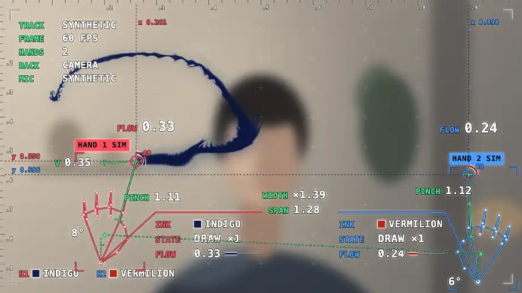
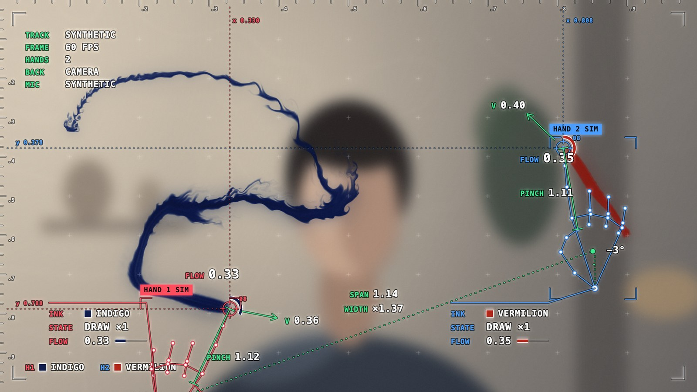
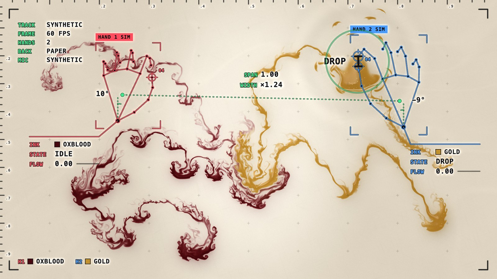
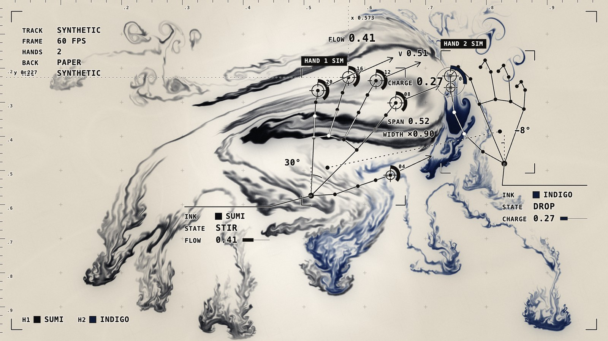

# Webcam Ink

Ink runs from your fingertips into water, over your own webcam picture, with the hand tracking drawn on top.



**Try it: https://native.express/lab/ink** (allow the camera and the microphone). No camera at hand? [The same page with `?demo=1&bg=video`](https://native.express/lab/ink?demo=1&bg=video) plays a loop with two synthetic hands, which is what the animation above shows.

Each hand carries its own pigment and the two mix where they meet. The overlay is a live debug view of the tracker: every number on it is a value the ink is driven by. One key records the result to a video file, either 16:9 or already framed for a vertical reel.

| | | |
| --- | --- | --- |
|  |  |  |

## Gestures

| | |
| --- | --- |
| Point | Ink flows from every straight finger. Faster movement, more ink. Curl a finger to lift it. |
| Pinch | Thumb and index together lets a drop fall: it blooms, throws a spray of fine droplets and sends a ring across the water. |
| Hold a pinch | Pigment gathers while you hold. Let go and a bigger drop falls, the longer you held the bigger. |
| Pinch with both hands | Pinching both at the same moment adds a spinning ring of both pigments between them, which marbles. |
| Open hand | All five fingers spread stirs the water without adding ink. |
| Snap | A finger snap switches between the camera picture and paper. The new background spreads out from the snapping fingers; the ink stays. |
| Clap twice | Two claps in quick succession do the same switch, spreading from where the hands met. |
| Two hands | The distance between them sets the stroke width: together for fine lines, apart for broad ones. |

Without a camera you get the paper background and the pointer: move to draw, click for a drop, hold Shift for the second ink. On a touch screen, drag to draw and tap for a drop.

## Keys

| | |
| --- | --- |
| `P` | Next palette (`Shift`+`P` goes back, `1`–`4` pick one) |
| `B` | Paper background / camera |
| `T` | Tracking marks: colour, quiet monochrome, skeleton only, off |
| `C` | Clear the water |
| `R` | Start or stop recording the stage (16:9) |
| `Shift`+`R` | Start recording framed for a reel (9:16); `R` stops it |
| `A` | Wide (16:9) or tall (9:16) stage |
| `F` | Fullscreen |
| `H` | Show or hide the help card |

Palettes: Sumi, Indigo & Vermilion, Oxblood & Gold, Celadon & Plum.

## Recording

`R` records the stage as you see it: 1920 × 1080. `Shift`+`R` records a reel frame instead: 1080 × 1920, with the 16:9 picture centred on near black, ready to post as a vertical video. Press `R` to stop either; the browser downloads `ink-<date>-<time>.mp4` (or `ink-reel-…`).

- The size of the clip does not depend on the size of the window.
- Up to 60 frames per second, no sound.
- The clip contains the picture, the ink and the tracking marks. The help card and the small red recording light are not in it.
- While a reel frame is being recorded the tracking marks are drawn with larger type and heavier lines, because the picture ends up 1080 wide.
- Format: MP4 (H.264) in Chrome. Firefox can only record WebM (VP8), which most editors open but Instagram does not accept directly.
- Keep the tab visible while recording; browsers stop drawing hidden tabs.

## Run it locally

```
npm install
npm run dev
```

Open http://localhost:5181 and allow the camera and the microphone. Node 22.18 or newer is needed (the tests are TypeScript run directly by Node).

- `npm run build` writes a static site to `dist/`. It uses only relative URLs, so it can be served from any path.
- `npm test` runs the checks described below.
- The first install or build downloads the hand model (7.8 MB) from Google's storage into `public/mediapipe/` and checks it against a pinned hash, so the site is self-contained. If that download fails, the build fails.

URL options:

- `?demo=1` plays a loop with no camera; `&bg=video` plays it over a stand-in for the camera picture.
- `?palette=2` starts on a given palette (0–3).
- `?bg=paper` starts on paper while still tracking your hands.
- `?overlay=full`, `mono`, `skeleton` or `off` sets the tracking marks.
- `?aspect=portrait` starts with the tall 9:16 stage, which crops the camera to its middle third.
- `?mic=off` does not ask for the microphone.
- `?q=low`, `medium` or `high` fixes the simulation size. Without it the page starts high and steps down if the machine struggles.

## How it works

**The water** is a small fluid simulation on the GPU, written for this project in WebGL 2. Each frame it applies forces (vorticity confinement to keep swirls alive, the slight weight of pigment so ink sinks, a slow ambient drift), carries the velocity field along itself, and removes divergence with a Jacobi pressure solve. Pigment is carried by the flow with a MacCormack correction, which keeps thin filaments from smearing away. A fingertip stroke is added as the exact trail of a moving gaussian dot, so lines stay even whatever the speed or frame rate.

**The picture** treats ink as pigment, not light. Each pigment has an absorption per colour channel and a body colour; thin washes tint what is underneath, thick ink goes dark and saturated, and where two pigments overlap their absorptions add. The ink bends the picture under it slightly, casts a soft shadow, and settles unevenly into a paper grain. Rings from drops and the wipe between backgrounds are distortions in the same final pass.

**The hands** come from MediaPipe's hand landmarker, which gives 21 points per hand. From those the page works out which fingers are straight, how far thumb and index are apart, and whether the hand is open, and turns that into drawing, dropping or stirring. Fingertip positions are smoothed twice (an adaptive filter on the tracker's samples, then a short follow at display rate) so strokes are steady but do not lag. The overlay draws those same points and numbers.

**Snaps and claps are heard.** They are short, sharp, broadband sounds, which a microphone picks out far more reliably than a camera, because hands blur and merge exactly when they meet. The page listens for a sudden onset well above the room level that is gone again a twentieth of a second later, and then asks the camera whether the hands could have made it:

- A snap counts if a hand had its thumb pressed to its middle finger right up to the sound, and straight after it the finger has left the thumb and folded into the palm. The overlay shows `ARMED` on a hand that is ready.
- A clap counts if both hands were close together, or closing on each other, within a third of a second of the sound. The two claps have to land within 0.9 seconds of each other; the first shows `CLAP 1/2` with a bar that runs down while a second would still count.
- A sharp sound the hands do not explain (talk, typing) shows as `HEARD +38 DB · NO HANDS` and does nothing.

If the microphone is refused or missing, the status block says `MIC OFF · CAMERA ONLY`. There is then no snap, and a double clap is read from the hands alone, which is less reliable.

**The demo** (`?demo=1`) poses two synthetic hands and feeds their joints, and its own made-up sounds, through the same gesture reading as real ones. Its tracking marks therefore show real values; only the tracking time reads `SYNTHETIC` and the hand tags read `SIM` instead of a confidence.

### What the overlay shows

- Top left: how long the last tracking pass took, the frame rate, hands in view, which background is showing, and a microphone level meter with a tick at the level a sound has to exceed.
- Around each hand: its skeleton, a bracketed box, and a tag saying which hand it is and how confident the tracker is.
- By the wrist: its pigment, what it is doing (`DRAW ×2`, `STIR`, `DROP`, `ARMED`, `IDLE`) and `FLOW`, the amount of ink it is putting out. While a pinch is held this becomes `CHARGE`.
- Between thumb and index: a caliper with the `PINCH` distance in hand sizes.
- On each straight fingertip: a reticle with its landmark number. The fastest drawing fingertip also gets its `FLOW`, an arrow with its speed `V`, and dotted lines out to the rulers with its position.
- At the wrist: how far the hand leans from upright. Between the hands: `SPAN` and the stroke `WIDTH` it sets.

### Tests

`npm test` runs three sets of checks with made-up input:

- the listening, on synthetic audio: claps, a soft snap, tones, speech-like and music-like sound;
- the pairing of sounds with hands: snaps and claps that should count, and lookalikes that should not;
- the camera-only clap reader, including tracks where the hands are lost at the moment they meet.

`tools/` also holds the scripts used to screenshot and record the page with Playwright, to check the build at different paths, and to make the pictures in this README.

## Browser support

What has actually been tried:

- **Chrome and Chromium on macOS**: everything, including recording to MP4, by script with a fake camera and microphone.
- **Firefox**: the page, the tracking and the overlay work. Recording gives WebM instead of MP4, and the microphone stays silent until the first key press or click (the status block says `PRESS ANY KEY` until then).
- **Safari, phones and tablets**: not tried.

By hand, the gestures have been used by one person, with one camera, in one room, and the thresholds were tuned there. Expect to adjust them (`src/hands.ts`, `src/gestures.ts`, `src/audio.ts`) if snaps or pinches are missed or fire by accident; the overlay shows which half of a check failed.

## Privacy

The camera picture and the microphone sound are processed in your browser and nowhere else. Nothing is recorded unless you press `R`, recordings are saved by your browser to your own disk, and they have no sound. The page makes no network requests beyond loading its own files; the hand model and the tracker's code are served with the site, not fetched from a third party.

## Layout

```
src/
  main.ts          wiring, frame loop, keys
  fluid.ts         the solver
  brush.ts         smoothing, and turning moving points into ink and motion
  hands.ts         camera and reading one hand's gesture
  gestures.ts      held pinches, double pinches, snaps and claps
  audio.ts         hearing sharp sounds through the microphone
  overlay.ts       tracking marks: skeletons, boxes, measurements, readouts
  recorder.ts      clip recording
  pointer.ts       mouse and touch
  demo.ts          the ?demo=1 choreography
  view.ts          final picture
  palettes.ts      pigments
  standin.ts       backdrop used by the demo in place of a camera
  shaders/sim.ts   advection, forces, pressure, splats
  shaders/look.ts  paper, camera grade, pigment and marks over the picture
tools/             tests, the asset copier, and Playwright scripts
docs/              pictures for this README, made by tools/make-docs.py
```

## Credits and licence

Hand tracking is [MediaPipe](https://github.com/google-ai-edge/mediapipe) Hand Landmarker, by Google, under the Apache License 2.0; see `THIRD_PARTY_NOTICES.md`. Built with Vite and TypeScript.

The code in this repository is by Robin Sadeghpour-Faraj and released under the MIT licence; see `LICENSE`.
